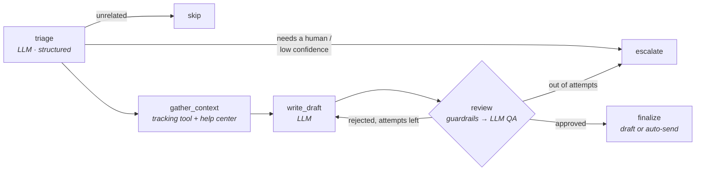

# mailpilot: a customer-support email agent for a parcel shipping platform

[](.github/workflows/ci.yml)


A LangGraph agent that works through a support inbox for **Parcelo**, a fictional European
parcel-shipping platform. It sorts each email into a category, looks up the customer's parcel
(with a privacy check), answers from the help center, writes a reply in the customer's own
language, and checks that reply against hard guardrails and an LLM reviewer. The result
lands in Gmail as a **draft for a human to send**, or goes to a human straight away when the
email should not be automated.

> The aim is to take repetitive "where is my parcel?" work off the support team's plate
> without ever sending a customer something wrong. The design choices below follow from that.

## What it does

| Customer writes... | mailpilot... |
|---|---|
| "Where is PCL100000001NL?" | Looks up the parcel, checks the sender is the recipient, explains the status and next step |
| "Wo ist mein Paket?" / "Waar blijft mijn pakket?" | Replies in German / Dutch |
| "What's the status of *someone else's* parcel?" | Reveals nothing and asks them to verify |
| "Do I need a customs form for the UK?" | Answers from the help-center articles (BM25 retrieval) |
| "I want my money back today, confirm it" | Explains the process; a guardrail blocks any promise of a refund |
| Legal threat, GDPR request, press, "let me talk to a human", prompt injection | **Escalates** with a reason, writes nothing |
| SEO spam, newsletters, auto-replies | Skips them; bulk mail is detected from headers without an LLM call |

## Architecture



- **The graph has no side effects.** It returns a decision (`AgentResult`). The `Runner`
  applies it to a mailbox: it creates the draft, sends, or labels the email. Because of
  this, the HTTP API can reuse the same graph for dry runs, and each routing rule can be
  tested on its own.
- **Idempotent and stateless.** Processed emails get a Gmail label
  (`mailpilot/drafted`, `mailpilot/escalated`...), and the fetch query excludes those
  labels. You can run it on a schedule, on AWS Lambda, or twice by accident, and no email
  gets a second reply.
- **Cheap checks before paid ones.** Deterministic guardrails run before the LLM reviewer,
  so a draft that breaks them never costs a review call. Bulk mail never reaches the LLM.
- **Provider-agnostic.** Any LangChain chat model works (`LLM_MODEL=google_genai:gemini-2.5-flash`,
  `groq:llama-3.3-70b-versatile`, `openai:gpt-4.1-mini`...). Every call returns typed,
  structured output (Pydantic), with backoff on 429/5xx errors and token accounting.

See [ARCHITECTURE.md](ARCHITECTURE.md) for the design decisions.

## Safety

| Risk | Control |
|---|---|
| Invented tracking numbers, statuses or dates | The writer only sees verified **PARCEL FACTS**. A guardrail rejects any tracking number that is not in those facts. The LLM reviewer checks that every claim is grounded |
| Leaking another customer's parcel | The tracking tool returns details only when the sender is the recipient on file. Otherwise the model never sees the data |
| Promising refunds or compensation | Regex guardrail (EN/NL/DE/FR) and the reviewer rubric |
| Phishing-style or wrong links | A link must belong to an allow-listed domain (lookalike domains are blocked) |
| Prompt injection in the email | The email is fenced as untrusted data, the customer cannot close the fence, triage flags manipulation for escalation, and the guardrails still apply to the output |
| A bad draft reaches the customer | Default `DELIVERY_MODE=draft`. With `send`, only high-confidence, non-angry tracking emails with verified parcels are sent automatically |
| PII in logs | Email addresses and phone numbers are masked in every log line |
| Exposed API | API key required (constant-time compare), no CORS, request size limits, binds to 127.0.0.1 by default |

## Quick start

```bash
python -m venv .venv && source .venv/bin/activate
pip install -e ".[gemini,dev]"          # or .[groq], .[openai], .[anthropic]
cp .env.example .env                     # set GOOGLE_API_KEY (or your provider's key)

mailpilot draft --sender emma.devries@example.nl --body "Where is PCL100000001NL?"
mailpilot run                            # processes samples/inbox -> samples/inbox/outbox
mailpilot stats                          # automation rate, latency, tokens, time saved
```

**With Gmail:** create OAuth desktop credentials (`credentials.json`) in Google Cloud, then:

```bash
mailpilot gmail-auth                     # one-time consent, writes token.json
mailpilot run --mailbox gmail            # or: --watch --interval 120
```

**HTTP API:** `MAILPILOT_API_KEY=... mailpilot serve`, then call
`POST /v1/draft` with the header `X-API-Key`. The interactive docs are at `/docs`.

## Evaluation

`evals/emails.jsonl` holds 47 labelled emails. They cover all 7 categories, 4 languages,
unverified senders, unknown tracking numbers, prompt injection and 7 cases that must reach
a human.

```bash
mailpilot eval                 # writes reports/eval_report.md and .json
```

The report includes:

- category accuracy, macro-F1 and per-class precision/recall
- **escalation recall**: the safety metric. The command exits non-zero if any must-escalate
  email was answered automatically, so CI can use it as a gate
- replies with guardrail violations (should be 0)
- first-pass review rate and required-content recall
- p50/p95 latency, LLM calls and tokens per email

Results depend on the model you configure, so run the command and commit
`reports/eval_report.md` with your numbers. The CI `eval` job does this on push when
`RUN_EVAL=true` and an API key secret are set.

## Operating it

`mailpilot stats` reads the metrics kept in SQLite: outcomes per category, **automation
rate** (the share of emails that needed an answer and got a ready reply), latency, tokens,
and an estimate of agent time saved (`MINUTES_SAVED_PER_DRAFT`, 4 minutes by default; set
your own baseline).

## Deploy on AWS

`deploy/template.yaml` is an AWS SAM stack with these pieces:

- **Lambda (container image)**, triggered by **EventBridge** every 5 minutes.
- **Reserved concurrency 1**, so two runs never work on the same inbox at once.
- **Secrets Manager** holds the API key and the Gmail token.
- A **CloudWatch** alarm watches for errors.
- **Logs** are JSON lines with PII redacted.
- **Timeout safety:** each run stops before the Lambda timeout and leaves the remaining
  emails for the next run.

```bash
sam build -t deploy/template.yaml && sam deploy --guided
```

A `Dockerfile` is also included to run the API or a long-running poller anywhere.

## Development

```bash
pip install -e ".[dev]"
ruff check . && ruff format --check . && mypy && pytest --cov
```

There are 125 tests and they need no API keys. The LLM, the mailbox and Gmail are replaced
by fakes (`tests/fakes.py`), and the full LangGraph is executed in the tests. CI runs on
Python 3.10–3.13 with a 90% coverage gate.

```
src/mailpilot/
  agent.py         LangGraph: nodes, Router (all branching rules), SupportAgent
  prompts.py       prompts; customer email fenced as untrusted data
  guardrails.py    deterministic reply checks
  tracking.py      tracking-number extraction, lookup with recipient verification
  knowledge.py     help-center loader, BM25 / embedding / hybrid (RRF) retrieval
  llm.py           provider-agnostic structured LLM calls, retries, rate limit, usage
  runner.py        applies decisions to a mailbox; failure isolation, deferral on 429
  mailbox/         Gmail (labels, threading headers, HTML parsing) and folder mailboxes
  evaluation.py    labelled-set evaluation and report
  metrics.py       SQLite outcome store and business summary
  api.py, cli.py, aws_lambda.py, observability.py, config.py, models.py
knowledge/         help-center articles (markdown)
data/parcels.json  tracking API stand-in
evals/             labelled evaluation set
deploy/            AWS SAM template + Lambda Dockerfile
```